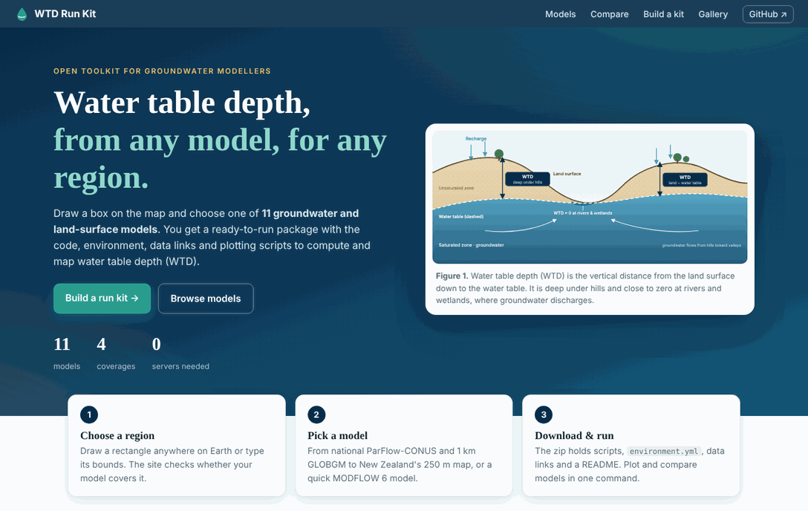
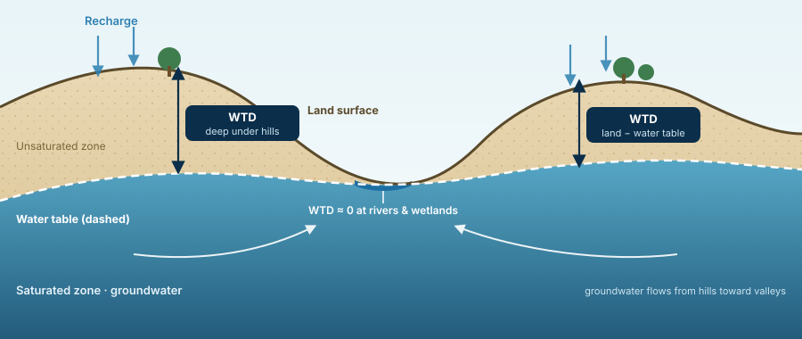
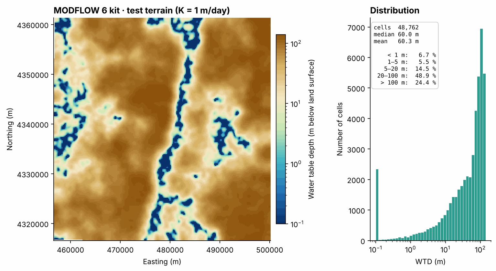
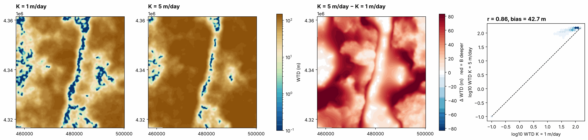

<div align="center">

# 💧 WTD Run Kit

### Water table depth from any model, for any region

**[Open the website →](https://mhaghiri.github.io/wtd-run-kit/)**

Draw a box on a map and pick one of **11 groundwater and land-surface models**. You get a ready-to-run package with code, environment, data links and plotting scripts that computes and maps **water table depth (WTD)** on your own machine.

[](https://mhaghiri.github.io/wtd-run-kit/)




</div>

---

## What is water table depth?



*Figure 1. Water table depth (WTD) is the vertical distance from the land surface down to the water table. It is deep under hills and near zero at rivers and wetlands, where groundwater discharges.*

## Models

| | Model | Scale | Resolution | Kit can… | Reference |
|---|---|---|---|---|---|
| 🟦 | **ParFlow-CLM** (CONUS1 / CONUS2) | Contiguous US | 1 km | run model · get results | Maxwell et al. 2015; Yang et al. 2023 |
| 🟪 | **WTM**, Water Table Model | North America | configurable | run model · get results | Callaghan et al. 2025, *GMD* |
| 🟧 | **Equilibrium Water Table** | Global | ~1 km | get results | Fan et al. 2013, *Science*; 2017, *PNAS* |
| 🟩 | **G³M** | Global | 5′ (~9 km) | run model · get results | Reinecke et al. 2019, *GMD* |
| 🟥 | **PCR-GLOBWB–MODFLOW** | Global | 5′ (~9 km) | run model · get results | de Graaf et al. 2015, 2017 |
| ⬛ | **GLOBGM v1.0** | Global | 30″ (~1 km) | run model · get results | Verkaik et al. 2024, *GMD* |
| 🟩 | **CLM** + lateral groundwater flow | Global | land-model grid | run model | Zeng et al. 2018, *JAMES* |
| 🟦 | **WBM**, Water Balance Model | Global | configurable | run model | Grogan et al. 2022, *GMD* |
| 🟫 | **VIC-WUR** (MODFLOW-coupled) | Global | configurable | run model | Droppers et al. 2020, *GMD* |
| 🟥 | **National Water Table, NZ** | New Zealand | 250 m | get results | Westerhoff et al. 2018, *HESS* |
| 🔵 | **MODFLOW 6 quick model** | Anywhere | you choose | run model | USGS MODFLOW 6 + FloPy |

**Run model** means the kit sets up or runs the model for your region. **Get results** means it clips WTD that the authors already published to your region.

## What's in a kit

```
my_wtd_run/
├── README.md          step-by-step guide for this model + region, with citation
├── config.json        your bounding box and settings
├── environment.yml    conda environment
├── clip_wtd.py        clip any WTD GeoTIFF / NetCDF (any projection) to your box
├── plot_wtd.py        WTD map + depth histogram
├── compare_wtd.py     compare two models: difference map, scatter, bias / RMSE / r
└── …                  model-specific scripts (ParFlow subsettools workflow, MODFLOW 6 builder, Fan downloader, DEM prep)
```

## Example outputs

| `plot_wtd.py` | `compare_wtd.py` |
|---|---|
|  |  |
| *Figure 2. WTD map (blue = shallow, brown = deep) with depth-class histogram.* | *Figure 3. Two MODFLOW runs (K = 1 vs 5 m/day): maps, difference, scatter.* |

<sub>Both figures come from the MODFLOW 6 kit run on synthetic test terrain. They show the output format, not results for a real place.</sub>

## Quick start

```bash
conda env create -f environment.yml
conda activate wtd-<model>
python clip_wtd.py --file <published_wtd.tif>      # or run the model, see the kit README
python plot_wtd.py outputs/wtd_<model>.tif
python compare_wtd.py outputs/wtd_A.tif outputs/wtd_B.tif --labels "Model A" "Model B"
```

## Repository layout

```
index.html, css/, js/       the website (static, GitHub Pages)
js/models.js                model catalog: metadata, links, citations
js/kits.js                  builds each kit (README, config, environment)
kit/shared/                 clip, plot, compare, DEM scripts used by every kit
kit/parflow/ kit/modflow/ kit/fan/   model-specific scripts
assets/                     figures
```

**Add a model:** add an entry to `js/models.js` and a guide to `GUIDE` in `js/kits.js`. Put any new scripts in `kit/<model>/`.

**Run the site locally:** `python -m http.server` in this folder, then open http://localhost:8000.

## Testing status

- ✅ Website, all 11 kit downloads, Python syntax of every script (headless browser test)
- ✅ MODFLOW 6 kit end to end, plus `clip_wtd.py` on projected (NZTM) GeoTIFFs and CLM-style NetCDF, `plot_wtd.py` and `compare_wtd.py`
- ⚠️ ParFlow kit follows the HydroFrame subsettools 2.x workflow. It hasn't been run here because it needs a HydroFrame account and a ParFlow install.
- ⚠️ For models without published gridded WTD, the kit gives setup steps and extraction scripts. Running them needs the model's own build and inputs.

## Citation

If WTD Run Kit helps your work, please cite the **original model papers** listed in each kit, and link to this repository.

## License

MIT for the code in this repository. Data and models belong to their authors under their own licences (e.g. NZ National Water Table © GNS Science 2019, CC BY 4.0).
